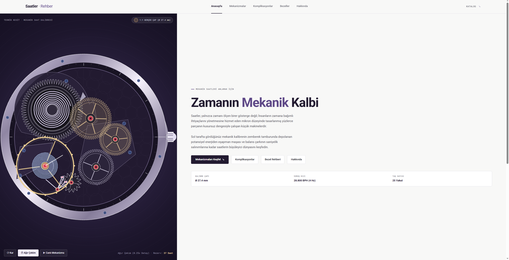
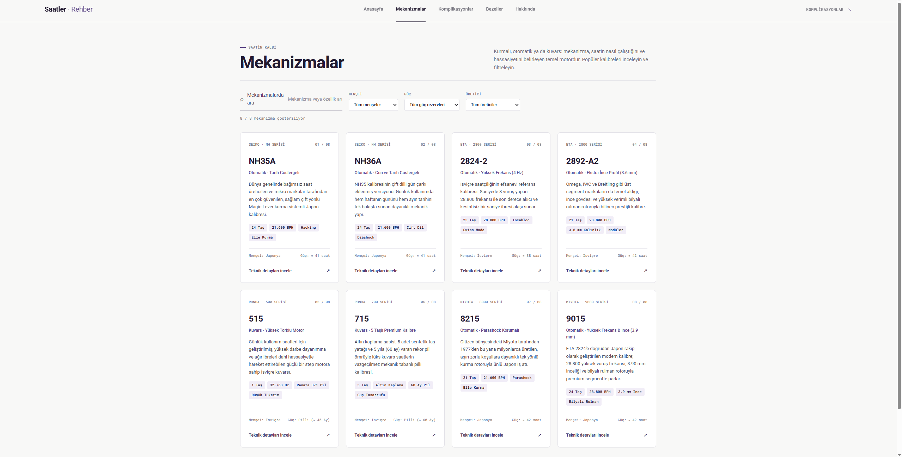
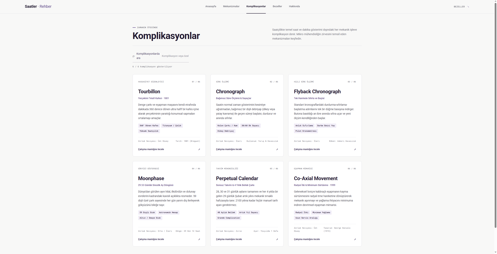
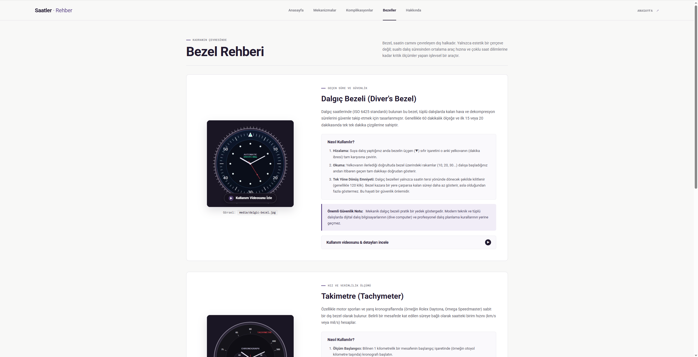

# Saat Bilgisi

Saat dünyasının mikro mühendislik harikalarını, mekanik kalibrelerini, komplikasyonlarını ve bezel fonksiyonlarını interaktif simülasyonlar ve kapsamlı teknik rehberlerle sunan modern bir web projesidir.

Proje, mekanik saatçiliğin karmaşık prensiplerini görselleştirerek herkes için anlaşılır kılmayı, yaygın kalibreleri karşılaştırmayı ve saat fonksiyonlarının doğru kullanımını öğretmeyi amaçlar.

---

## 📸 Proje Ekran Görüntüleri ve Bölümler

### 1. Anasayfa & İnteraktif Mekanik Kalibre Simülasyonu
Anasayfa, saat kasası içerisine yerleştirilmiş ve sıfırdan HTML5 Canvas ile matematiksel olarak modellenmiş çalışan bir mekanik kalibreye ev sahipliği yapar.



- **İnteraktif Mekanik Kalibre:** Zemberek tamburundan eşapman maşasına, balans çarkından saniye dişlisine kadar tüm aktarım zinciri gerçek zamanlı olarak hareket eder.
- **Dönen Kurma Kolu (Winding Crown):** "Kur" butonuna tıklandığında veya kurma kolu fare/dokunmatik ile sürüklendiğinde kurma kolu dönerek zembereği kurar ve güç rezervini yeniler.
- **Hız Kontrolü:** Canlı çalışma hızı ve mekanizmanın salınım detaylarını mikron düzeyinde incelemeyi sağlayan **Ağır Çekim (0.25x)** modu.
- **Kasa Entegrasyonu:** Saat 3 yönündeki koruma omuzları (crown guards), çelik kasa kenarları ve teknik göstergeler.

---

### 2. Mekanizmalar Kataloğu ve Çok Kriterli Filtreleme
Saat dünyasında en yaygın kullanılan mekanik ve kuvars kalibrelerin teknik özelliklerini, güvenilirliklerini ve mimarilerini bir araya getiren interaktif veritabanı.



- **Zengin Kalibre Listesi:** Seiko (NH35A, NH36A), ETA (2824-2, 2892-A2), Ronda (515, 715) ve Miyota (8215, 9015).
- **Gelişmiş Arama & Filtreleme:**
  - Anlık metin araması (kalibre adı, vuruş hızı, özellik).
  - **Menşei:** İsviçre / Japonya.
  - **Güç Türü:** Otomatik Mekanik / Pilli Kuvars.
  - **Üretici:** Seiko, ETA, Ronda, Miyota.
- **Detaylı Özellik Kartları:** Vuruş hızı (BPH), taş sayısı (Jewels), rezerv süresi, çap, şok koruma sistemleri (Diashock, Incabloc, Parashock) ve "Teknik detayları incele" modal pencereleri.

---

### 3. Komplikasyonlar Kataloğu
Saatçilikte zamanı göstermenin ötesine geçen yüksek mühendislik fonksiyonlarını (komplikasyonları) sade ve teknik bir dille anlatan bölüm.



- **Ele Alınan Komplikasyonlar:**
  - **Tourbillon:** Yerçekiminin balans çarkı üzerindeki konumsal sapmalarını nötrleyen 360° dönen kafes sistemi.
  - **Chronograph:** Bağımsız süre ölçümü, kolon çarkı ve dikey kavrama mimarileri.
  - **Flyback Chronograph:** Tek buton hamlesiyle durdurma, sıfırlama ve yeniden başlatma döngüsü.
  - **Moonphase:** 29.53 günlük sinodik ay döngüsünü 59 dişli diskle yansıtan astronomik gösterge.
  - **Perpetual Calendar (Sonsuz Takvim):** 28, 30, 31 günlük ayları ve 4 yılda bir gelen artık yılları mekanik bellekle takip eden takvim.
  - **Co-Axial Movement:** George Daniels tarafından geliştirilen, sürtünmeyi ve yağlama ihtiyacını minimuma indiren radyal itkili eşapman.
- **Arama Desteği & Detay Pencereleri:** Her komplikasyonun icat yılı, zorluk derecesi ve çalışma mantığına dair popover detayları.

---

### 4. Bezel Rehberi ve Pratik Kullanım Kılavuzları
Saat kasasını çevreleyen bezellerin yalnızca estetik bir unsur olmadığını; profesyonel dalıştan motor sporlarına ve havacılığa kadar kritik işlevler taşıdığını gösteren uygulamalı rehber.



- **Bezel Türleri:**
  - **Dalgıç Bezeli (Diver's Bezel - ISO 6425):** Dalış süresi ve dekompresyon takibi, tek yöne dönüş emniyeti (120 klik).
  - **Takimetre (Tachymeter):** 1 km mesafede geçen süreye göre ortalama hızı hesaplayan logaritmik skala ve formüller.
  - **GMT Bezeli:** Çift yönlü 24 saatlik skala ve GMT ibresiyle 3 farklı zaman dilimini aynı anda takip etme.
- **Entegre Video Eğitimleri:** Her bezelin görseli veya "Kullanım Videosunu İzle" butonuna tıklandığında açılan entegre YouTube eğitim videoları.
- **Güvenlik İpuçları:** Kritik ölçümler ve mekanik saat güvenliği için hayati uyarı notları.

---

### 5. Hakkında Sayfası
Projenin ortaya çıkış gerekçelerini, mekanik saatçiliğin mikro mühendislik felsefesini, sürdürülebilirlik boyutunu ve projenin teknik standartlarını içeren kapsamlı künye sayfasıdır.

---

## 🛠️ Kullanılan Teknolojiler

- **HTML5:** Semantik etiketler (`<header>`, `<nav>`, `<main>`, `<section>`, `<article>`, `<footer>`) ve WAI-ARIA erişilebilirlik standartları.
- **CSS3:** Flexbox ve CSS Grid ile tamamen responsive (mobil, tablet, masaüstü uyumlu) arayüz, modern cam efektleri (Glassmorphism) ve animasyonlar.
- **Vanilla JavaScript (ES6+):** Sıfır harici kütüphane bağımlılığı; modüler mimari, dinamik filtreleme algoritmaları, modal kontrolü ve YouTube iframe API entegrasyonu.
- **HTML5 Canvas API:** Matematiksel dişli fiziği, harmonik salınım formülleri ve gerçek zamanlı mekanizma render motoru.
- **Tipografi:** Google Fonts Roboto ve teknik veriler için Roboto Mono.

---

## 📁 Proje Dosya Yapısı

```text
saatbilgisi/
│
├── index.html              # Anasayfa ve interaktif mekanizma simülatörü
├── mekanizmalar.html       # Mekanizmalar kataloğu ve filtreleme sistemi
├── komplikasyonlar.html    # Komplikasyonlar kataloğu ve detay kartları
├── bezeller.html           # Bezel rehberi ve video eğitimleri
├── hakkinda.html           # Konu seçim gerekçeleri ve proje künyesi
│
├── styles.css              # Ortak stil dosyası (responsive, dark theme, animasyonlar)
├── script.js               # Canvas simülasyonu, filtreleme ve modal fonksiyonları
│
├── media/                  # Görsel ve medya dosyaları
│   ├── tanitim1.PNG        # Anasayfa ekran görüntüsü
│   ├── tanitim2.PNG        # Mekanizmalar sayfası ekran görüntüsü
│   ├── tanitim3.PNG        # Komplikasyonlar sayfası ekran görüntüsü
│   ├── tanitim4.PNG        # Bezel rehberi ekran görüntüsü
│   ├── dalgic-bezel.jpg    # Dalgıç bezel fotoğrafı
│   ├── takimetre-bezel.jpg # Takimetre fotoğrafı
│   └── gmt-bezel.jpg       # GMT bezeli fotoğrafı
│
└── README.md               # Proje tanıtım ve çalıştırma dokümantasyonu
```

---

## 🚀 Nasıl Çalıştırılır?

Sunucu `8000` portunda çalışıyor. VS Code **Ports** panelinde `8000` portunu bulun ve **Open in Browser** seçin. `127.0.0.1:8000` adresini Codespace dışındaki tarayıcıya doğrudan yazmayın; VS Code'un yönlendirdiği bağlantıyı kullanın.

Sunucuyu yeniden başlatman gerekirse proje klasöründe:

```bash
python3 -m http.server 8000 --bind 0.0.0.0
```

> **Yerel Ortamda Çalıştırma (Alternatif):**  
> Projeyi bilgisayarınızda yerel olarak açmak isterseniz proje dizininde herhangi bir terminal açıp `python -m http.server 8000` komutunu çalıştırabilir ve tarayıcınızdan `http://localhost:8000` adresine gidebilir ya da VS Code **Live Server** eklentisini kullanabilirsiniz.
